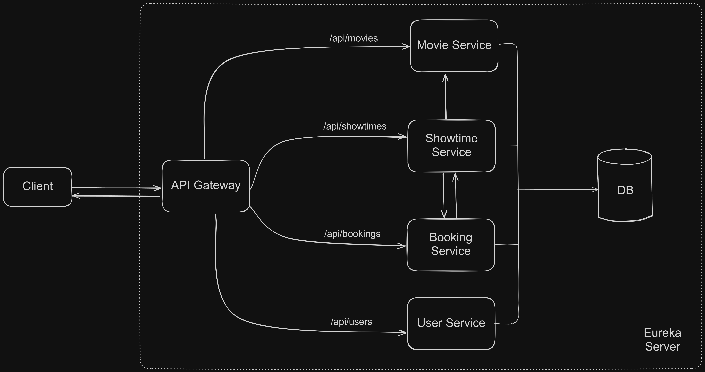

# CineBook — Movie Ticketing Microservices

CineBook is a local movie catalog and ticket-booking application. A React frontend calls a Spring Cloud Gateway; Eureka discovers the Java services. MySQL stores users, movies, showtimes and bookings. Memurai/Redis holds ticket quantities temporarily before confirmation.



## Features and architecture

| Module | Purpose | Port | Dependencies |
|---|---|---:|---|
| `eureka-server` | Service registry and dashboard | 8762 | None |
| `api-gateway` | Route discovery, JWT validation, local CORS | 9090 | Eureka; four APIs |
| `user-service` | BCrypt registration, login, current user | Dynamic | MySQL; Eureka |
| `movie-service` | Movie lookup and admin CRUD | Dynamic | MySQL; Eureka |
| `showtime-service` | Showtime lookup, admin creation, Redis holds and inventory | Dynamic | MySQL; Memurai/Redis; Eureka; Movie and Booking Feign clients |
| `booking-service` | Authenticated booking creation and owned history | Dynamic | MySQL; Eureka; User and Showtime Feign clients |
| `frontend` | React UI | 5173 | Gateway |

The stack is Java 17, Spring Boot 3.4.0, Spring Cloud 2024.0.0-RC1, Maven Wrapper 3.9.9, MySQL 8, Redis, React 18, TypeScript, Vite and Tailwind CSS. The four data services use `server.port=0`; use the gateway rather than their changing ports.

A user logs in at `/api/user/login` and receives a raw five-hour JWT whose subject is the username and whose `role` claim is `USER` or `ADMIN`. The gateway validates the bearer token and forwards it to services. User Service protects `/api/user/me` and resolves the numeric user ID. Booking Service calls `/me` over Feign instead of trusting a browser-supplied `userId`. Movie and Showtime admin endpoints require `ADMIN`. **Existing limitation:** public registration still accepts a requested role; restrict that server-side before exposing this app publicly.

For a booking, Booking Service asks Showtime Service to create a five-minute quantity hold in Redis. Lua scripts atomically account for concurrent holds and remove expired ones. Confirmation reduces MySQL inventory under a pessimistic row lock; cancellation releases an active hold. Booking Service saves the booking after confirmation. Redis and the two MySQL services do not share a transaction: a crash between seat deduction and booking persistence requires reconciliation. The old direct seat-deduction endpoint responds with 410 Gone so it cannot bypass holds.

## Project layout

```text
api-gateway/       Spring Cloud Gateway and JWT filter
eureka-server/     Eureka registry
user-service/      Authentication and user identity
movie-service/     Movie catalog
showtime-service/  Showtime inventory and Redis reservations
booking-service/   Bookings and owned history
frontend/          React UI
media/             Architecture diagram
seed/              Repeatable sample movie/showtime SQL and runner
scripts/           Reusable booking/reservation verification scripts
service.ps1        Run or test one backend service
start-all.ps1      Start all backend services in separate processes
```

## Prerequisites and configuration

Install JDK 17, MySQL 8, Memurai/Redis on `localhost:6379`, and Node.js/npm. Each service includes its own `mvnw.cmd`; install no separate Maven. Create the existing `movie_ticketing` database if absent. Entity tables are managed by the current JPA `ddl-auto=update` configuration. The sample seed is optional; it preserves existing rows:

```powershell
.\seed\run-seed.ps1
```

Set `SPRING_DATASOURCE_PASSWORD` and one shared `JWT_SECRET` for all JWT services. The JWT key must be Base64 for at least 32 random bytes. `.env.example` lists variable names but is not loaded automatically. The startup script reads the ignored `.local/application-local.properties`; create it with your own values:

```properties
spring.datasource.password=YOUR_LOCAL_MYSQL_PASSWORD
jwt.secret=YOUR_SHARED_BASE64_KEY
```

Generate a key in PowerShell with `$bytes=New-Object byte[] 64; [Security.Cryptography.RandomNumberGenerator]::Fill($bytes); [Convert]::ToBase64String($bytes)`. Store it only in local configuration or environment variables. Never commit `.local/`, real `.env` files, passwords or tokens. The gateway CORS origin is `http://localhost:5173`; the frontend `.env.example` points to `http://localhost:9090`. Reservation duration defaults to 300 seconds and can be set with `RESERVATION_DURATION_SECONDS` for testing. Redis is configured in Showtime Service at `localhost:6379`.

## Run locally (Windows PowerShell)

From the project root, with MySQL and Redis running:

```powershell
.\start-all.ps1
```

Or use a separate terminal for each service, in this order:

```powershell
.\service.ps1 -Service eureka-server
.\service.ps1 -Service user-service
.\service.ps1 -Service movie-service
.\service.ps1 -Service showtime-service
.\service.ps1 -Service booking-service
.\service.ps1 -Service api-gateway
```

Allow Eureka to load at `http://localhost:8762/` first. For the frontend:

```powershell
cd frontend
npm install
npm run dev
```

Open `http://localhost:5173`. The gateway is `http://localhost:9090`. The scripts use the local properties file; invoking `mvnw.cmd` directly requires the equivalent environment configuration.

## API examples

Public: `POST /api/user/register` with `{"username":"viewer","password":"...","role":"USER"}`; `POST /api/user/login` with username and password returns a raw JWT. Use `Authorization: Bearer <JWT>` below.

| Method | Gateway path | Purpose |
|---|---|---|
| GET | `/api/user/me` | Authenticated ID, username, role |
| GET | `/api/movies`, `/api/movies/{id}` | Catalog and movie detail |
| POST / PUT / DELETE | `/api/movies/admin`, `/api/movies/admin/{id}` | Admin movie management |
| GET | `/api/showtimes`, `/api/showtimes/{id}` | Screenings and detail |
| POST | `/api/showtimes/admin` | Admin showtime creation |
| POST | `/api/showtimes/reservations` | Hold `{"showtimeId":3,"quantity":2}` |
| GET | `/api/showtimes/reservations/{id}` | Hold status and expiry |
| POST | `/api/showtimes/reservations/{id}/confirm` | Confirm hold |
| POST | `/api/showtimes/reservations/{id}/cancel` | Cancel hold |
| POST | `/api/bookings` | Book `{"showtimeId":3,"seatsBooked":2}` |
| GET | `/api/bookings/mine` | Current user's bookings |

The reservation response has `reservationId`, `showtimeId`, `quantity`, `status`, and `expiresAt`. Existing legacy booking lookups by user ID are restricted to the authenticated owner. The frontend does not display a stored booking date because no such column exists.

```powershell
$body=@{username='viewer';password='your-password'} | ConvertTo-Json
$token=Invoke-RestMethod http://localhost:9090/api/user/login -Method Post -ContentType application/json -Body $body
Invoke-RestMethod http://localhost:9090/api/movies -Headers @{Authorization="Bearer $token"}
Invoke-RestMethod http://localhost:9090/api/showtimes -Headers @{Authorization="Bearer $token"}
```

## Testing and troubleshooting

Run `./service.ps1 -Service <name> -Action test` for each backend module. To build independently, run `.\mvnw.cmd clean package` inside its directory with the same local configuration. Run `npm run build` in `frontend/`. `scripts/booking-flow.ps1` and `scripts/reservation-flow.ps1` exercise live gateway flows and **create test accounts/bookings**; use them only against your local test database. They assume a seeded showtime and require all services running. Logs and generated builds are ignored.

If a service fails to start, check MySQL/Redis availability, the shared JWT key, and its Maven output. A 503 soon after startup can mean Eureka has not refreshed; wait for clients to register. A 401 means the bearer token is absent or invalid. A 409 reservation response means insufficient free tickets or a reservation already completed. Frontend network errors can indicate a stopped gateway or a CORS origin other than `http://localhost:5173`.

## Future improvements

Restrict public role assignment; add durable reconciliation or an outbox for cross-service booking failures; add booking timestamps/status, broader unit and integration tests, production secret management, and production CORS settings. The current local configuration and `ddl-auto=update` are development defaults, not a production migration strategy.
