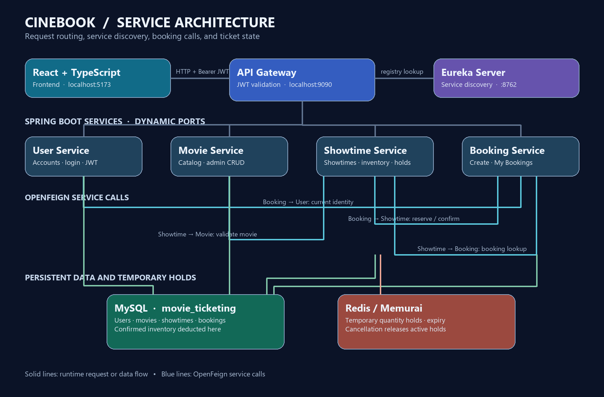

# CineBook – Movie Ticket Booking Platform

**Browse movies, choose a showtime, and book tickets through a React client and Spring Boot microservices.**

     

[Architecture](#architecture) · [Services](#services) · [Run locally](#run-locally) · [API](#api) · [GitHub repository](https://github.com/ROHAN-3105/CineBook)

## Overview

CineBook pairs a React and TypeScript frontend with six Java services. Spring Cloud Gateway is the API entry point; Eureka discovers service instances. JWTs protect requests, MySQL stores accounts, movies, showtimes and bookings, and Redis holds ticket quantities while a booking is completed.

## Architecture



[Editable Mermaid source](media/cinebook-architecture.mmd)

1. The frontend calls Gateway on port `9090`. Login returns a signed JWT; later requests carry it as a bearer token. Gateway validates the token and routes by service name.
2. Eureka on port `8762` discovers User, Movie, Showtime and Booking services, each running on a dynamic port. Booking and Showtime use OpenFeign for service calls.
3. Booking Service looks up the authenticated user, then asks Showtime Service for a temporary quantity hold. Redis Lua scripts account for concurrent holds and expiry (300 seconds by default).
4. The owner may inspect or cancel an active hold. Confirmation deducts MySQL seat inventory under a pessimistic row lock; Booking Service then saves the booking.

## Features

| Area | Implemented behavior |
|---|---|
| Identity | Registration, BCrypt password storage, login, five-hour JWT, current-user lookup |
| Authorization | Gateway JWT validation; `ADMIN` checks on movie and showtime management |
| Catalog | Movie listing/details, admin movie CRUD, showtime listing/details and admin creation |
| Tickets | Seat availability, Redis holds with expiry, confirmation and cancellation |
| Bookings | Authenticated creation and owner-scoped **My Bookings** history |
| Service calls | Eureka discovery and OpenFeign between Booking, Showtime, Movie and User services |

## Technology

| Layer | Stack |
|---|---|
| Frontend | React 18 · TypeScript 5 · Vite 6 · Tailwind CSS 3 |
| Backend | Java 17 · Spring Boot 3.4 · Spring Security · JWT |
| Data and caching | MySQL 8 · Redis / Memurai |
| Communication | Spring Cloud Gateway · Eureka · OpenFeign |
| Tools | Maven Wrapper · Node.js · npm · PowerShell |

## Services

| Module | Responsibility | Port |
|---|---|---:|
| [Eureka Server](eureka-server/README.md) | Service registry | `8762` |
| [API Gateway](api-gateway/README.md) | Routing, JWT check, local CORS | `9090` |
| [User Service](user-service/README.md) | Accounts, login and identity | Dynamic |
| [Movie Service](movie-service/README.md) | Catalog and admin CRUD | Dynamic |
| [Showtime Service](showtime-service/README.md) | Screenings, inventory and Redis holds | Dynamic |
| [Booking Service](booking-service/README.md) | Bookings and owned history | Dynamic |
| [Frontend](frontend/README.md) | React client | `5173` |

## Screenshots

No genuine application screenshots are stored in this repository yet. Add captures of the running CineBook frontend here.

## Project structure

```text
api-gateway/       Gateway routes and JWT filter
eureka-server/     Service registry
user-service/      Accounts and tokens
movie-service/     Movie catalog
showtime-service/  Showtimes and Redis reservations
booking-service/   Bookings and history
frontend/          React and TypeScript UI
media/             Architecture diagrams
seed/              Repeatable sample data
scripts/           Live flow checks
service.ps1        Run or test one backend module
start-all.ps1      Start all backend modules
```

## Run locally

**Prerequisites:** JDK 17, Node.js/npm, MySQL 8 and Redis or Memurai on `localhost:6379`. Each service includes `mvnw.cmd`; global Maven is unnecessary.

1. Create the `movie_ticketing` MySQL database. The four data services use `jdbc:mysql://localhost:3306/movie_ticketing`, user `root`, and JPA `ddl-auto=update`.
2. Create ignored `.local/application-local.properties` in the project root with your own values. Use one shared Base64 key of at least 32 random bytes across JWT services:

   ```properties
   spring.datasource.password=YOUR_LOCAL_MYSQL_PASSWORD
   jwt.secret=YOUR_SHARED_BASE64_KEY
   ```

   [`.env.example`](.env.example) documents variable names but is not loaded automatically. Generate a key in PowerShell with `$bytes=New-Object byte[] 64; [Security.Cryptography.RandomNumberGenerator]::Fill($bytes); [Convert]::ToBase64String($bytes)`. Never commit local configuration.
3. Start MySQL and Redis/Memurai. From the root run `.\start-all.ps1`, or start each service in a separate PowerShell terminal, Eureka first:

   ```powershell
   .\service.ps1 -Service eureka-server
   .\service.ps1 -Service user-service
   .\service.ps1 -Service movie-service
   .\service.ps1 -Service showtime-service
   .\service.ps1 -Service booking-service
   .\service.ps1 -Service api-gateway
   ```

4. Start the UI:

   ```powershell
   cd frontend
   npm install
   npm run dev
   ```

Open `http://localhost:5173`. `VITE_API_BASE_URL` defaults to `http://localhost:9090`; Gateway CORS permits `http://localhost:5173`. Optionally run `.\seed\run-seed.ps1` from the root to add repeatable movie and showtime data.

## API

All paths use `http://localhost:9090`. Except registration and login, send `Authorization: Bearer <JWT>`.

| Method | Path | Purpose |
|---|---|---|
| POST | `/api/user/register` | Register |
| POST | `/api/user/login` | Return raw JWT |
| GET | `/api/user/me` | Current user |
| GET | `/api/movies`, `/api/movies/{id}` | Catalog and detail |
| POST / PUT / DELETE | `/api/movies/admin`, `/api/movies/admin/{id}` | Admin movie management |
| GET | `/api/showtimes`, `/api/showtimes/{id}` | Screenings and detail |
| POST | `/api/showtimes/admin` | Admin showtime creation |
| POST / GET | `/api/showtimes/reservations`, `/api/showtimes/reservations/{id}` | Create or inspect a hold |
| POST | `/api/showtimes/reservations/{id}/confirm`, `/cancel` | Confirm or cancel a hold |
| POST | `/api/bookings` | Create a booking |
| GET | `/api/bookings/mine` | Owned history |

```powershell
$body = @{username='viewer'; password='your-password'} | ConvertTo-Json
$token = Invoke-RestMethod http://localhost:9090/api/user/login -Method Post -ContentType application/json -Body $body
Invoke-RestMethod http://localhost:9090/api/movies -Headers @{Authorization="Bearer $token"}
$booking = @{showtimeId=3; seatsBooked=2} | ConvertTo-Json
Invoke-RestMethod http://localhost:9090/api/bookings -Method Post -ContentType application/json -Headers @{Authorization="Bearer $token"} -Body $booking
```

The booking request omits `userId`; the server resolves ownership. Registration currently requires `username`, `password` and `role`.

## Tests

Run `.\service.ps1 -Service <module> -Action test` for each backend module, or `.\mvnw.cmd clean test` inside one module with equivalent configuration. Run `npm run build` in `frontend/`. [`scripts/booking-flow.ps1`](scripts/booking-flow.ps1) and [`scripts/reservation-flow.ps1`](scripts/reservation-flow.ps1) exercise a running local stack; they create test accounts/bookings and expect seeded showtimes.

## Limitations and future work

- Public registration currently accepts a requested role, including `ADMIN`. Restrict role assignment server-side before public deployment.
- Redis holds and Booking/Showtime MySQL writes do not share a transaction. A crash after seat deduction but before booking persistence requires reconciliation.
- Current JPA `ddl-auto=update` and fixed local CORS origin are development settings. Production needs migrations, managed secrets and environment-specific CORS.
- Future work includes reconciliation/outbox handling, booking timestamps and statuses, broader integration tests and genuine UI screenshots.
